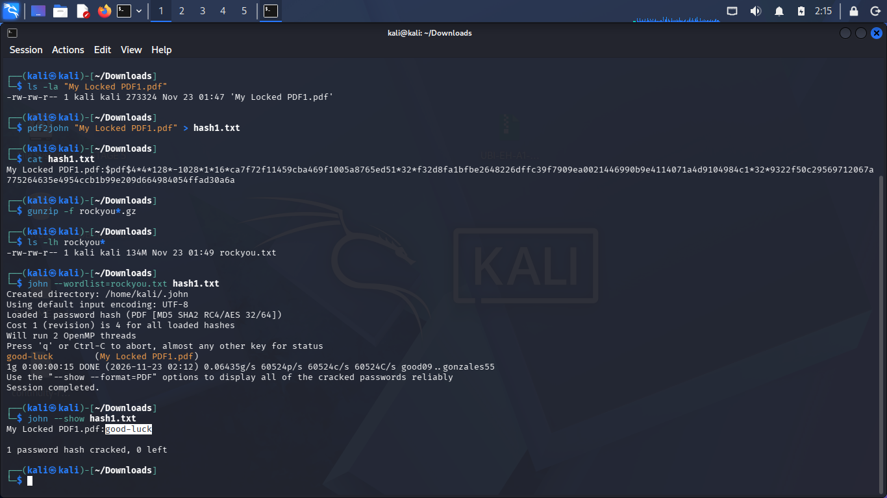
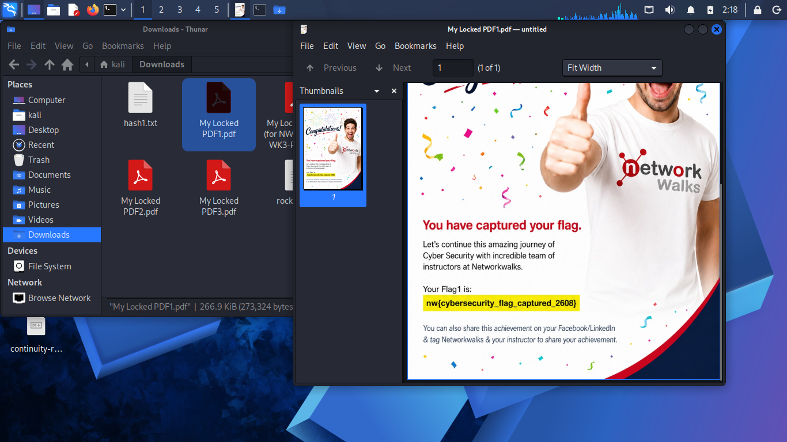
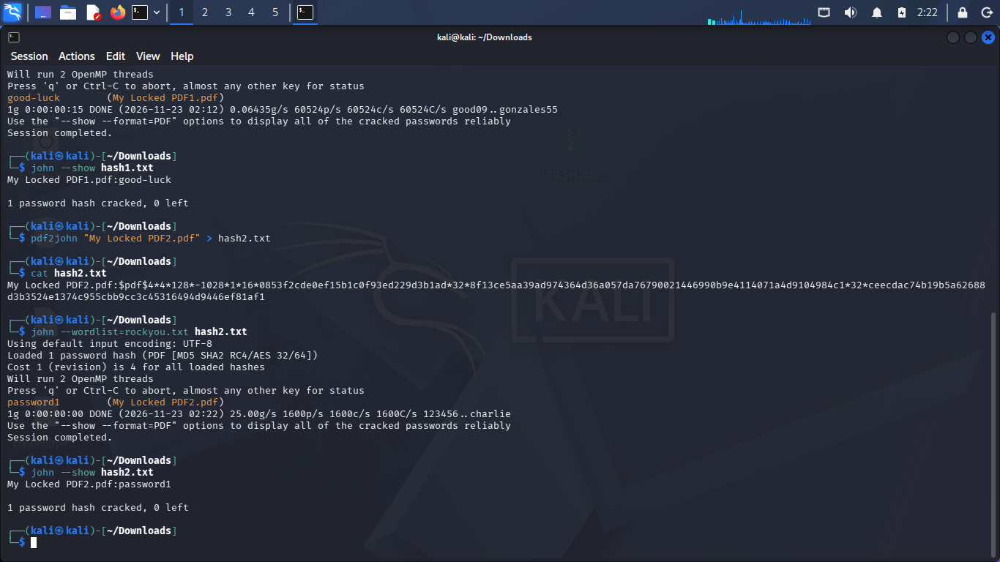
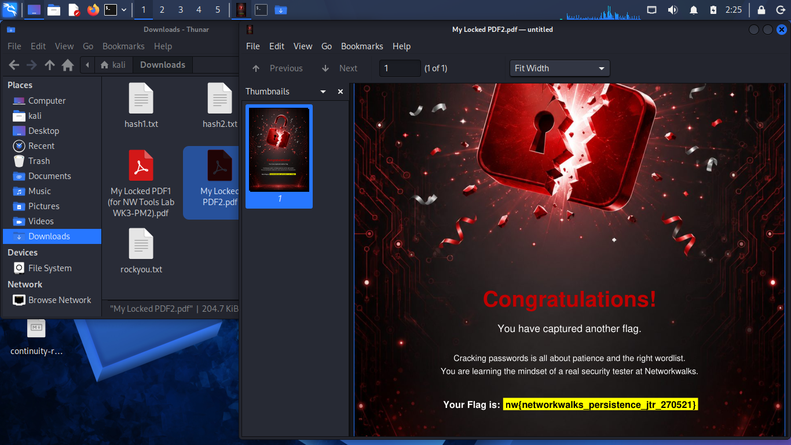
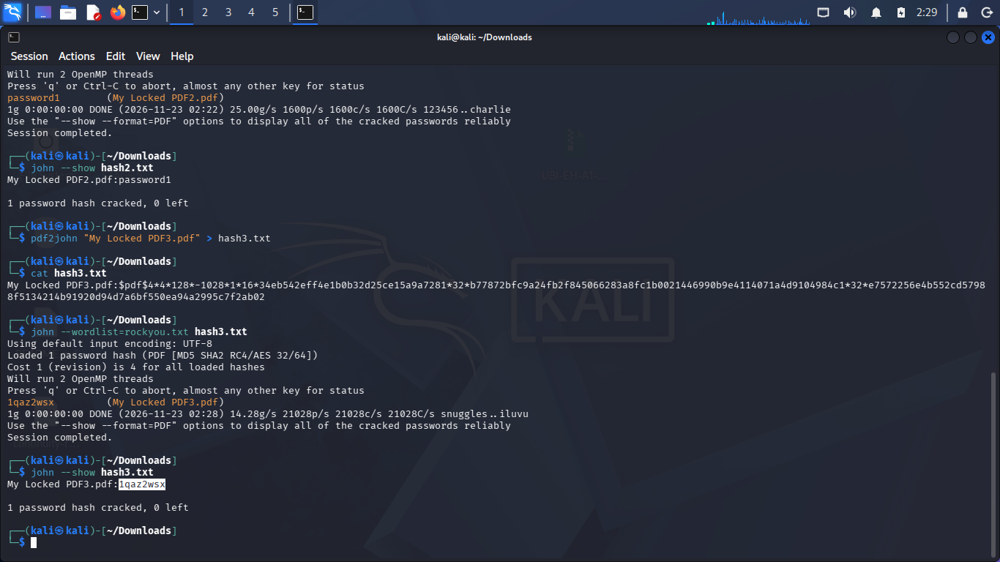
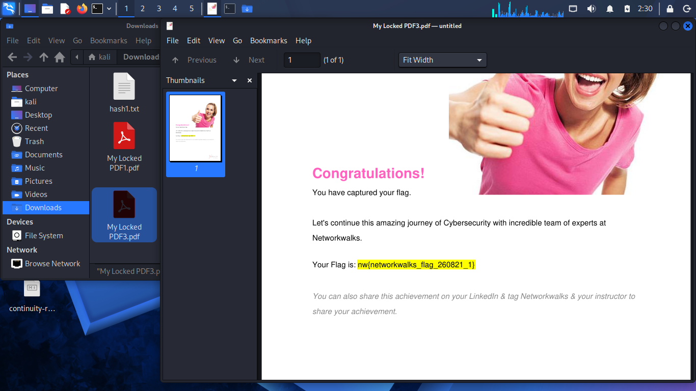
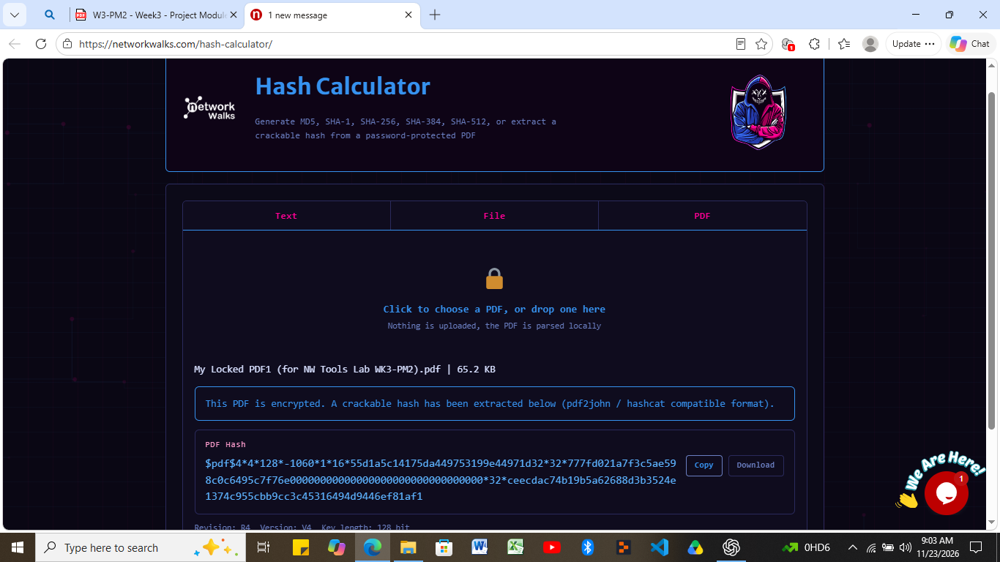
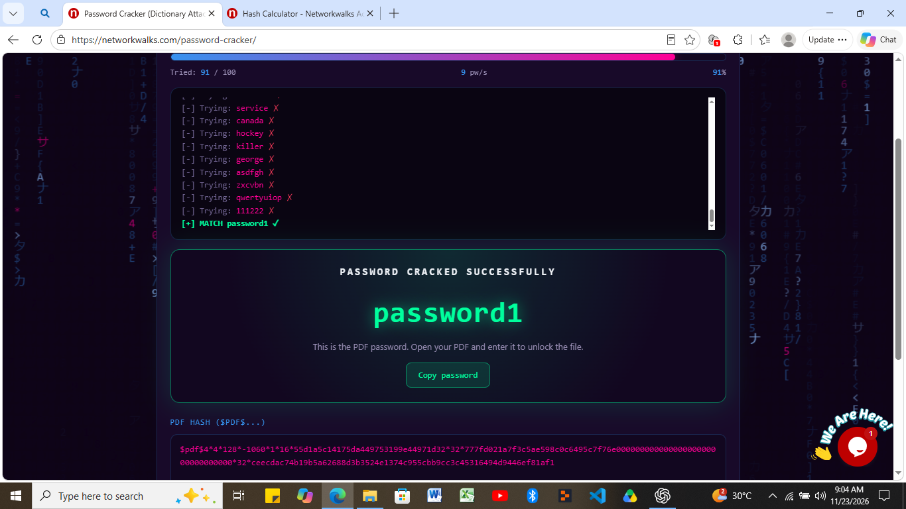
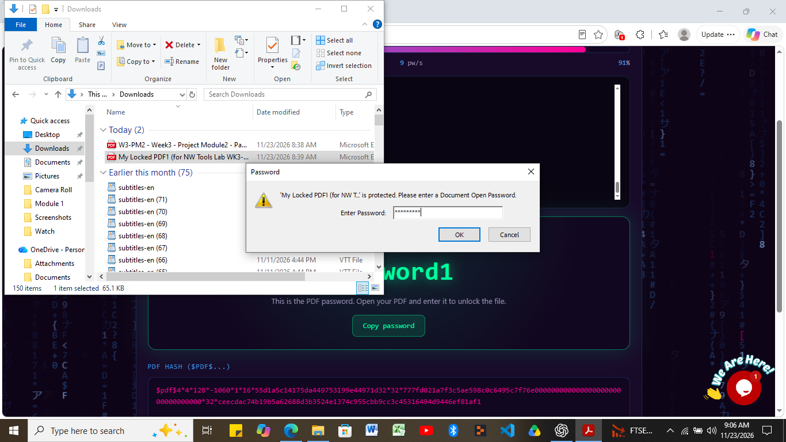
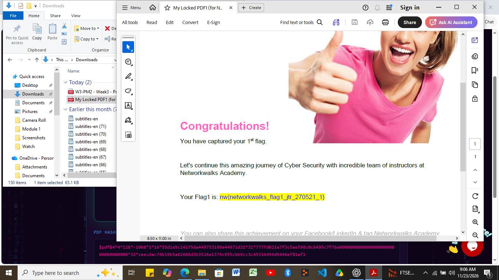

# Password Cracking & Cryptographic Analysis Report

**Engagement:** Networkwalks Cybersecurity Internship — Week 3 Project (Batch B084)  
**Author:** Kabiru Soliu (`@DraZay`)  
**Scope:** Authorized Offline Cryptographic Hash Extraction & Dictionary-Based Password Recovery (`W3-PM1` & `W3-PM2`)  
**Environments:** Kali Linux (`pdf2john`, John the Ripper) & Windows 10 Browser Sandbox (Networkwalks Hash Calculator & Password Cracker)  

> **Rules of Engagement & Authorization:** All password extraction and offline dictionary recovery activities documented in this report were performed exclusively against authorized training artifacts provided by Networkwalks Academy. [View Letter of Authorization](Letter-of-Authorization.md)

---

## Executive Summary

During Week 3 of the Networkwalks Cybersecurity Internship, two complementary password auditing modules were executed to evaluate document encryption resilience against offline dictionary attacks:

1. **Module 1 (`W3-PM1` — CLI Cryptanalysis with John the Ripper):** Extracted 128-bit RC4/AES PDF encryption hashes (`$pdf$4*4*128*...`) from three password-protected documents (`My Locked PDF1.pdf`, `My Locked PDF2.pdf`, and `My Locked PDF3.pdf`) inside Kali Linux using `pdf2john`, then executed dictionary attacks against the extracted `rockyou.txt` wordlist via John the Ripper (`john`). All three credentials were recovered within seconds, exposing the embedded verification flags.
2. **Module 2 (`W3-PM2` — Browser-Based Cryptanalysis with Networkwalks Tools):** Parsed `My Locked PDF1 (for NW Tools Lab WK3-PM2).pdf` locally using the Networkwalks Hash Calculator and recovered its plaintext password (`password1`) via the Networkwalks Dictionary Password Cracker, verifying full document decryption.

---

## Summary of Findings & Captured Flags

| Module | Target Artifact | Encryption Profile | Tooling Used | Recovered Password | Captured Flag |
| :--- | :--- | :--- | :--- | :--- | :--- |
| **W3-PM1** | `My Locked PDF1.pdf` | PDF v4 / Rev 4 (128-bit) | `pdf2john` + `john` (`rockyou.txt`) | `good-luck` | `nw{cybersecurity_flag_captured_2608}` |
| **W3-PM1** | `My Locked PDF2.pdf` | PDF v4 / Rev 4 (128-bit) | `pdf2john` + `john` (`rockyou.txt`) | `password1` | `nw{networkwalks_persistence_jtr_270521}` |
| **W3-PM1** | `My Locked PDF3.pdf` | PDF v4 / Rev 4 (128-bit) | `pdf2john` + `john` (`rockyou.txt`) | `1qaz2wsx` | `nw{networkwalks_flag_260821_1}` |
| **W3-PM2** | `My Locked PDF1 (for NW Tools Lab WK3-PM2).pdf` | PDF v4 / Rev 4 (128-bit) | Networkwalks Hash Calculator & Cracker | `password1` | `nw{networkwalks_flag1_jtr_270521_1}` |

---

## Cryptographic Mechanics: Hashing vs. Encryption

Understanding why offline dictionary attacks succeed rapidly against weak passwords requires distinguishing two foundational cryptographic primitives:

* **Symmetric Encryption (Two-Way):** Protects the confidentiality of the PDF document body using a secret key derived from the user's password. Given the correct key, ciphertext can be reversed back into readable plaintext.
* **Cryptographic Hashing (One-Way):** Transforms an input password into a fixed-length digest (`$pdf$4*4*128*...`) stored inside the PDF's encryption dictionary alongside the salt and permissions flags (`-1028` / `-1060`). Because hash functions are non-reversible, cracking tools operate by hashing candidate words from a wordlist (`rockyou.txt`) with the extracted salt and comparing the resulting digest against the target hash until a byte-for-byte collision occurs.

---

## Module 1 (`W3-PM1`): Password Cracking with John the Ripper (Kali Linux)

### 1. Target 1 — `My Locked PDF1.pdf`
* **Hash Extraction & Cracking:** Extracted the `$pdf$4*4*128*...` hash using `pdf2john`, decompressed `rockyou.txt.gz`, and executed `john --wordlist=rockyou.txt hash1.txt`. John cracked the hash in 15 seconds, recovering **`good-luck`**.
* **Verification:** Unlocked `My Locked PDF1.pdf` and captured flag **`nw{cybersecurity_flag_captured_2608}`**.

---

### 2. Target 2 — `My Locked PDF2.pdf`
* **Hash Extraction & Cracking:** Extracted the hash into `hash2.txt` and ran John the Ripper against `rockyou.txt`. Because the password appeared near the top of the leaked credential frequency list (`123456..charlie`), John recovered **`password1`** instantaneously (`< 1 second`).
* **Verification:** Unlocked `My Locked PDF2.pdf` and captured flag **`nw{networkwalks_persistence_jtr_270521}`**.

---

### 3. Target 3 — `My Locked PDF3.pdf`
* **Hash Extraction & Cracking:** Extracted the hash into `hash3.txt` and executed `john --wordlist=rockyou.txt hash3.txt`, recovering the predictable keyboard-walk credential **`1qaz2wsx`** in under a second.
* **Verification:** Unlocked `My Locked PDF3.pdf` and captured flag **`nw{networkwalks_flag_260821_1}`**.

---

## Module 2 (`W3-PM2`): Browser-Based Cracking with Networkwalks Tools

### 1. Local Client-Side Hash Extraction
Uploaded `My Locked PDF1 (for NW Tools Lab WK3-PM2).pdf` (65.2 KB) into the **Networkwalks Hash Calculator** (`networkwalks.com/hash-calculator/`). The browser-side parser extracted the John/Hashcat-compatible `$pdf$4*4*128*-1060*...` hash without transmitting the document externally.

### 2. Dictionary Attack Execution
Submitted the extracted `$pdf$...` hash string to the **Networkwalks Password Cracker** (`networkwalks.com/password-cracker/`) using its built-in 100-entry common password dictionary. At attempt `91 / 100` (`9 pw/s`), the tool matched **`password1`**.

### 3. Decryption & Flag Verification
Entered **`password1`** into the PDF Document Open Password prompt and confirmed access to the unlocked document, capturing flag **`nw{networkwalks_flag1_jtr_270521_1}`**.

---

## Defensive Hardening & Remediation Recommendations

1. **Enforce High-Entropy Passphrases (14+ Characters):** All four recovered passwords (`good-luck`, `password1`, `1qaz2wsx`) are common dictionary words or adjacent keyboard patterns found in standard breach wordlists (`rockyou.txt`). Sensitive files should be protected with randomly generated passphrases of at least 14–16 characters combining uppercase, lowercase, digits, and symbols.
2. **Upgrade Legacy PDF Encryption Revisions:** Standard PDF Revision 4 (128-bit RC4/AES) relies on fast MD5-based key derivation loops, enabling high-speed offline GPU/CPU guessing. Configure PDF security policies to enforce **AES-256 (PDF 2.0 / ISO 32000-2)** encryption, which incorporates stronger SHA-256 key-stretching iterations.
3. **Eliminate Credential Reuse & Keyboard Walks:** Block predictable keyboard-walk patterns (`1qaz2wsx`, `qwertyuiop`) and breached credentials via automated password-policy filters (NIST SP 800-63B guidelines) before issuing encrypted archives to external recipients.
